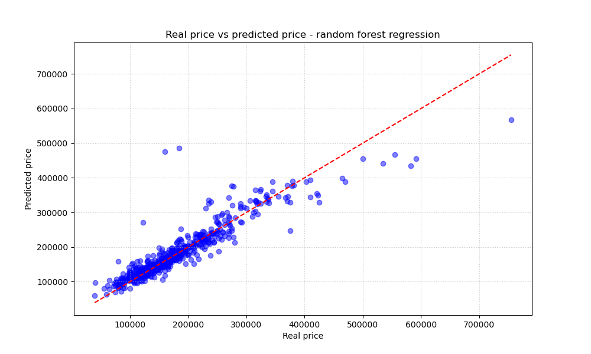
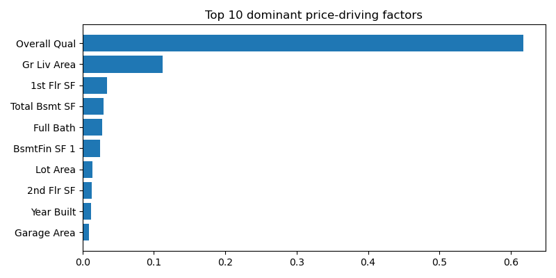

# Ames Housing - Price Prediction

An exploratory machine learning project comparing regression models for residential property price prediction using the Ames Housing dataset. The project focuses not only on predictive performance, but also on preprocessing choices, model interpretation, and the limitations revealed during experimentation.

### 📝 Overview

This project explores several approaches to predicting residential property sale prices using the Ames Housing dataset. It progresses from a numerical-only Linear Regression baseline to models using both numerical and categorical features, Random Forest, PCA-based dimensionality reduction, and neural networks.

The goal is to compare approaches, investigate which features carry predictive information, and understand where the models succeed or struggle. This is an **exploratory learning project**, not a production-ready pricing system. Its results are preliminary and point to several opportunities for more rigorous validation and improvement.

### 🗃️ Dataset

The [Ames Housing dataset](http://jse.amstat.org/v19n3/decock/AmesHousing.txt), compiled by Dean De Cock at Truman State University, contains 2,930 residential property sales in Ames, Iowa, from 2006–2010. The data includes property characteristics such as lot and living area, quality ratings, garage and basement details, year built, and neighbourhood. The target variable is `SalePrice`.

The repository includes `AmesHousing.csv`. The dataset can also be obtained from the [original source](http://jse.amstat.org/v19n3/decock/AmesHousing.txt) or [Kaggle](https://www.kaggle.com/datasets/shashanknecrothapa/ames-housing-dataset).

### ⚙️ Workflow and methods

1. Split the data into training and test sets (80/20).
2. Handle missing values, distinguishing between values that need imputation and numeric fields where zero represents an absent feature.
3. Train a **Linear Regression baseline** using numerical features only.
4. Standardize numerical features and inspect linear coefficients.
5. Train **Linear Regression** using numerical and one-hot encoded categorical features.
6. Train a **Random Forest Regressor** and inspect its built-in feature importance.
7. Apply **Principal Component Analysis (PCA)** at several explained-variance thresholds (70%-99%) and compare MAPE against models trained without PCA.
8. Inspect the loadings of the first principal component.
9. Train an **MLP Regressor** using scikit-learn and estimate permutation importance.
10. Build a **Keras/TensorFlow neural network** with dense layers, dropout, validation monitoring, and early stopping; inspect learning curves and permutation-style feature importance.

**Evaluation metric:** Mean Absolute Percentage Error (MAPE). Lower values indicate smaller average absolute percentage errors.

### 📊 Results

The following values are from the notebook's current 80/20 train-test split. They are preliminary results, not a cross-validated estimate of expected performance.

| Model | Features | Test MAPE |
| :--- | :--- | :---: |
| Linear Regression | Numerical only | ≈ 15.0% |
| Linear Regression | Numerical + categorical | ≈ 10.9% |
| Random Forest Regressor | Numerical + categorical | ≈ 10.5% |
| MLP Regressor | Numerical + categorical | ≈ 11.4% |
| Deep Neural Network (Keras) | Numerical + categorical | ≈ 10.9% |

The largest improvement came from adding categorical features to the Linear Regression baseline: MAPE decreased from approximately 15.0% to 10.9%. In this experiment, Random Forest achieved the lowest test MAPE, although the difference between the best-performing models was relatively small.

#### Predicted vs. actual prices - Random Forest



The Random Forest predictions generally track actual prices more closely for low- and mid-priced homes. However, some individual properties are substantially overpredicted, and the models tend to underpredict the most expensive homes. These errors highlight why a single summary metric does not tell the whole story.

#### Key price-related features



In the current Random Forest model, `Overall Qual` accounts for approximately 61.8% and `Gr Liv Area` for approximately 11.3% of the model's built-in feature importance. Together, they represent over 70% of the reported importance. Across the experiments, the recurring groups of useful predictors include **overall quality, living area, and location/neighbourhood**.

Feature importance describes how a model uses features for prediction; it does not establish causality or, by itself, show whether a feature increases or decreases the predicted price.


### 🔎 Observations and lessons learned

- **Feature representation matters.** Adding categorical variables substantially improved the Linear Regression baseline, showing that preprocessing and feature representation can matter as much as the choice of algorithm.
- **Predictive performance and interpretability are different challenges.** The Linear Regression models produced extremely large coefficients (around `1e14`–`1e16`). This is consistent with numerical instability caused by strong multicollinearity and redundant features. For example, `Gr Liv Area` is derived from the sum of `1st Flr SF`, `2nd Flr SF`, and `Low Qual Fin SF`. The resulting coefficients should not be interpreted as reliable measures of individual feature effects.
- **More complex models are not automatically better.** The MLP Regressor did not outperform the expanded Linear Regression model in this experiment. Random Forest achieved the lowest observed test MAPE among the models compared.
- **PCA involved a trade-off rather than an improvement.** In the tested configurations, PCA did not beat the corresponding no-PCA baselines. Linear Regression improved as more components were retained, while Random Forest performance changed less and drifted slightly in the opposite direction. These observations apply to the tested setup, not to every possible PCA configuration.
- **Feature importance needs context.** The MLP ranked `Pool QC_Gd`, a relatively rare category, highly. This may reflect the model's reliance on a small group of properties rather than a broadly applicable price driver. Rankings from different importance methods are not directly interchangeable.
- **Some individual predictions remain unreliable.** Scatter plots show substantial errors for certain properties and underprediction at the high end of the price range. This reinforces the need to inspect residuals and segment-level performance, not only overall MAPE.

### ⚠️ Limitations and next steps

This notebook is an exploratory baseline and has not yet been developed into a rigorously validated modelling pipeline. The most useful next improvements would be:

- **Validate more robustly.** Use cross-validation or repeated splits to check whether the observed model ranking and performance differences are stable.
- **Outlier analysis.** Identify and investigate outliers in target prices and key numerical features, assess their impact on model performance, and determine whether any additional preprocessing is justified.
- **Improve regression diagnostics.** Report MAE and RMSE alongside MAPE, and inspect residuals and performance across price ranges.
- **Tune hyperparameters systematically.** Compare models under a documented search strategy instead of relying mostly on predefined configurations.
- **Revisit feature redundancy.** Investigate multicollinearity and redundant aggregate features before interpreting linear coefficients.

### ▶️ Running
1. Download `AmesHousing.csv` (see [Dataset](#️-dataset)) and place it in the project root.
2. Install dependencies
```bash
pip install -r requirements.txt
```
3. Open the notebook in Jupyter
```bash
jupyter notebook price-prediction.ipynb
```
4. Run all cells (Run All)

Plots are displayed inline and also saved to the `images/` directory.

### 👤 Author

Kamil Mędrek

---